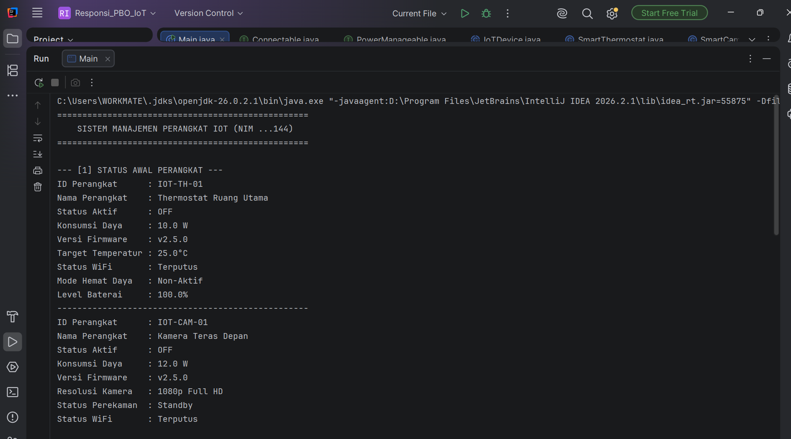

# Responsi Akhir Pemrograman Berorientasi Objek

## Identitas Mahasiswa
- **Nama**: Muhammad Gilang Ramadhani
- **NIM**: H1D025144
- **Digit Terakhir NIM**: 4
- **Tema Sistem**: IoT (Internet of Things)

## Petunjuk Compile dan Run (Terminal)
1. Buka terminal pada root direktori proyek ini.
2. Kompilasi seluruh source code:
   javac *.java
3. Jalankan class utama:
   java Main

## Screenshot Luaran Program
